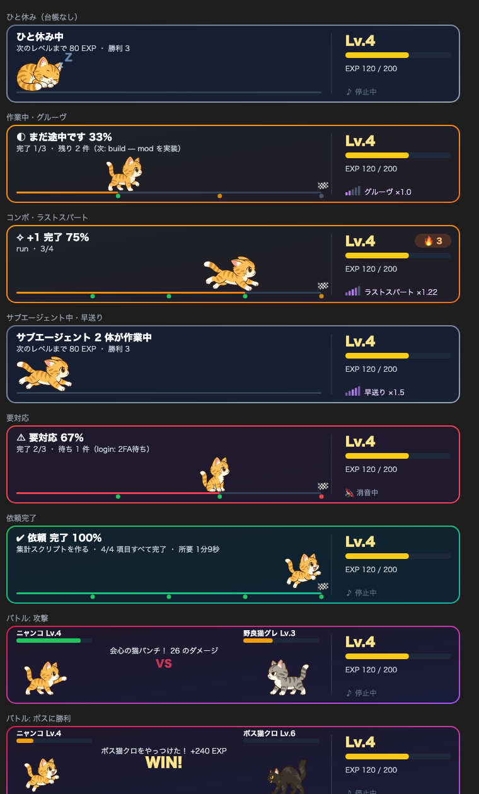
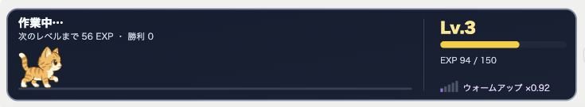
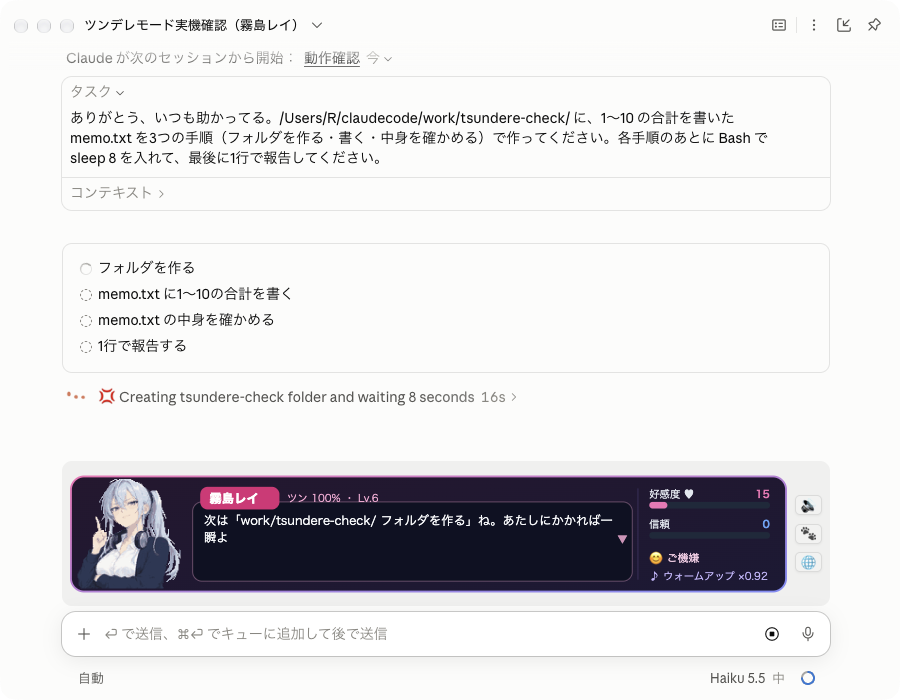

# done-board

Claude Code の作業を、入力欄の上に常にいるニャンコ・作業BGM・ご褒美の音で見えるようにするプラグインです。
項目を1つ終えるたびにコンボ音が鳴り、残りが減るほど BGM が速くなり、ニャンコもゴールへ向かって走ります。
使ったトークンでニャンコに経験値がたまってレベルが上がり、ときどき近所の野良猫とバトルになります。



実際のデスクトップアプリでの表示:



## インストール

Claude Code をターミナルで開き、プロンプトに次の1行を入力します。

```
/plugin install done-board --marketplace bw-bit/done-board
```

`Add marketplace?` には `y` を押し、スコープを選びます。ユーザースコープで入れると、デスクトップアプリの Code タブのセッションでも動きます。

## 何をするか

| 場面 | 看板 | 音 |
| --- | --- | --- |
| 作業が始まる | — | 進み具合に合ったテンポで BGM を流す |
| 項目が1つ終わる | `+1 完了` と 🔥 連続数 | コンボ音（連続するほど高くなる） |
| テンポが上がる | テンポメーターの点灯が増える | レベルアップ音のあと、速い曲に切り替わる |
| 残り1件 | — | ラストスパート（×1.22）の曲 |
| 人の操作待ち | 赤い「要対応」と理由 | BGM を止める |
| 依頼がすべて終わる | リングが満ちる完了カード | BGM を止めてファンファーレ |
| 台帳のない短いやり取り | 小さな「ターン完了」 | 鳴らさない（30秒以上かかったターンだけ鳴らす） |

看板は 14 秒ほどで薄くなってから消えます。右端の ✕ でも消せます。デスクトップでは進捗リング付きのカード、ターミナルでは枠付きの2段表示になります。

BGM のテンポは4段階です。

| 段階 | 速さ | 切り替わる目安 |
| --- | --- | --- |
| ウォームアップ | ×0.92 | 完了 1/3 未満 |
| グルーヴ | ×1.0 | 1/3 以上 |
| ドライブ | ×1.1 | 2/3 以上 |
| ラストスパート | ×1.22 | 残り1件 |

## ニャンコ

| 場面 | ニャンコ |
| --- | --- |
| 何もしていない | 丸くなって眠る（Zz） |
| 作業中 | 進み具合の位置まで歩く。BGM が速くなるほど走る |
| サブエージェントが動いている | 全力で駆ける。BGM は早送り（×1.5）に変わる |
| 人の操作待ち | おすわりして待つ |
| 依頼がすべて終わる | ゴールで跳びはねる |

- **経験値とレベル**：消費トークン 500 ごとに 1 EXP（キャッシュからの読み込みは数えません）。サブエージェントが使った分も入ります。Lv2 は 50 EXP、Lv5 は 500 EXP、Lv10 は 2,250 EXP です。経験値はセッションをまたいで残ります。
- **野良猫バトル**：前回から3ターン以上たつと、ターンの終わりに15%の確率で野良猫グレが現れ、自動で戦います。Lv3 からは、4回に1回ボス猫クロが出ます。勝つと相手のレベルに応じて経験値が入ります。
- **降ってくるプロンプト**：送ったプロンプトの文字（最大40文字）が、帯の上に色とりどりに降ってきて、6秒ほどで消えます。スラッシュコマンドは降りません。
- **撫でる**：マウスで猫にホバーすると、体がふにっと縮んで、ハートと「ゴロゴロ…♡」が出ます。帯の横の 🐾 ボタンを押すとゴロゴロ音が鳴ります。撫でた回数は残ります。
- **音のオンオフ**：帯の横の 🔊 ボタンで、BGM と効果音をまとめて消せます。設定はセッションをまたいで残ります。

## ツンデレモード（霧島レイ）

`/tsundere on` で、帯がギャルゲー風の会話ウィンドウに変わります。主人公の先輩でツンデレのエンジニア「霧島レイ」が、作業を上から目線で実況します。`/tsundere off` でニャンコに戻ります。


実際のデスクトップアプリでの表示:



**パラメータ**（セッションをまたいで残ります）

| 名前 | 範囲 | 上がる・下がる |
| --- | --- | --- |
| 好感度 ♥ | 0〜100 | お礼・ほめ言葉・ていねいな依頼・項目の完了・依頼の完了で上がる。乱暴な言い方で下がる |
| 信頼 | 0〜100 | 長くて具体的な依頼・項目の完了で上がる |
| 機嫌 | −50〜50 | 言葉づかいで上下し、ターンごとに 0 へ戻っていく |

好感度で態度が変わります：ツン 100%（0〜24）→ ちょいデレ（25〜49）→ デレ期（50〜79）→ デレデレ（80〜99）。100 に届くと攻略完了のイベントがあり、以後は「攻略済み ♥」になります。

**プロンプトの読み取り**

| プロンプト | レイの反応 |
| --- | --- |
| 「ありがとう」「助かった」「さすが」 | 照れる。「べ、別にお礼なんていらないわよ…」 |
| 「かわいい」「好き」「レイさん」 | 赤面。「な、何言ってんのよ急に…！」 |
| 「早くしろ」「使えない」など | 怒る。機嫌が下がる |
| 深夜（0〜5時） | 心配する。「…べ、別に心配なんかしてないから」 |
| 120 文字を超える具体的な依頼 | ドヤ顔。信頼が上がる |
| 6 文字未満の短い依頼 | 「もうちょっとちゃんと説明しなさいよ」 |

**作業の実況**：ツールを使うたび（「探してあげるわ。感謝しなさい」）、項目を始めたとき（「次は『集計』ね」）、終えたとき（「『集計』、終わらせてあげたわ。…褒めてもいいのよ？」）、人の操作待ち、依頼の完了、サブエージェント、レベルアップで、表情を変えてひとこと言います。考え中の表示・ヒント・ターンの終わりの行もツンデレの口調になります。

**コマンド**：`/tsundere`（パラメータを見る）・`/tsundere gift`（コーヒーを差し入れる。1 時間に 1 回、好感度 +4）・`/tsundere reset`（最初に戻す）

レイはこのプラグインのためのオリジナルのキャラクターで、立ち絵は画像生成で作り、図形に変換しています。

## 画面の猫仕立て

帯のほかにも、Claude Code が描き替えを許している場所に猫を入れています（設定 `catTheme` で切れます）。

| 場所 | 変わり方 | 出る画面 |
| --- | --- | --- |
| 考え中の表示 | ターミナルは「毛づくろいしながら考え中 🐾」などの猫のしぐさ。デスクトップは「🐾 Creating notes.md」のように作業内容に肉球を添える | ターミナル・デスクトップ |
| 入力欄の下のヒント | もとの案内のあとに「🐈 がんばってるニャ（Lv.3）」「🐾 Enter で送るニャ」 | ターミナル・デスクトップ |
| 入力欄の右下のモード表示 | 「🐈 Lv.3」を足す | ターミナル・デスクトップ |
| 確認ダイアログ | 質問の頭に 🐈 | すべて |
| 自分のプロンプトの行 | 頭に 🐾 | すべて |
| このプラグインのコマンドの出力 | ニャンコの吹き出し | すべて |
| ターンの終わりの行 | 「🐾 1分4秒はたらいたニャ」 | ターミナル |
| ツールの行 | 種類ごとの猫の顔（読む 🐱👓・編集 🐱✏️・コマンド 🐱🔧・検索 🐱🔍 など）の後にもとの行 | ターミナル |
| お知らせ・裏に回すヒント | 🐈 や「ニャ」を添える | ターミナル |

もとの情報（作業内容・キーの案内・ツールの結果）は消さずに残します。

## 完了台帳

看板とテンポは、作業フォルダの `work/autonomy/completion-<session_id>.json` を読んで決まります。プラグインがセッションごとにこの場所と書き方を Claude に伝えるので、手順のある作業を頼めば Claude が自分で台帳を書きます。形式は次のとおりです。

```json
{
  "status": "running",
  "request_summary": "集計スクリプトを作る",
  "items": [
    { "id": "plan", "status": "done", "note": "手順を決める" },
    { "id": "script", "status": "running", "note": "スクリプトを書く" },
    { "id": "report", "status": "pending", "note": "結果をまとめる" }
  ]
}
```

`status` は `pending`・`running`・`done`・`blocked` のどれかです。台帳がないときは、ターンの終わりに「ターン完了」だけを出します。

## コマンド

- `/bgm` — BGM の状態と連続数を表示
- `/bgm off` — BGM を止める（このセッションのあいだ）
- `/bgm on` — BGM を再開する
- `/nyanko` — ニャンコのレベル・経験値・勝利数を表示
- `/nyanko battle` — 今すぐ野良猫と戦う
- `/nyanko mute` — 音のオンオフを切り替える（🔊 ボタンと同じ）
- `/localhost` — localhost で動いている開発サーバーをペインで一覧する（帯の 🌐 ボタンでも開く）

## localhost の管理

帯の右上に、localhost で動いている開発サーバーの数（🌐 localhost 2）が出ます。`/localhost` か 🌐 ボタンで開くペインには、ポート・コマンド・起動したフォルダが並び、次の操作ができます。

- **開く**：`http://localhost:<ポート>` をブラウザで開く
- **止める**：1回押すと「もう一度押すと止めます」に変わり、2回目でそのプロセスに終了の合図（SIGTERM）を送る
- **全部見る**：AirPlay などの常駐アプリや一時ポートも含めて表示する

一覧は `lsof` で20秒ごとに更新します。止められるのは、一覧に出ている自分のプロセスだけです。

## 設定

`/plugin` の設定画面で変えられます。

| 項目 | 既定 | 内容 |
| --- | --- | --- |
| `ledgerDir` | `work/autonomy` | 台帳を置くフォルダ。相対パスは作業フォルダ基準 |
| `music` | オン | 作業 BGM |
| `musicVolume` | 0.35 | BGM の音量（0〜1） |
| `effects` | オン | コンボ音・レベルアップ音・ファンファーレ |
| `debugLog` | オフ | 作業フォルダの `.claude/done-board-debug.log` に動作を記録 |
| `battles` | オン | ときどき野良猫が出てきて戦う |
| `character` | `nyanko` | 帯のキャラクター（`nyanko` か `tsundere`）。`/tsundere on`・`off` でも切り替えられる |
| `catTheme` | オン | 考え中の表示・ヒント・確認ダイアログ・ツールの行などを猫仕立てにする |
| `promptHint` | オン | 台帳の場所と書き方をシステムプロンプトで Claude に伝える |

## 動く環境

- 音は macOS の `afplay` で再生します。Linux と Windows のターミナルでは音は鳴らず、看板だけが出ます。
- 看板は入力欄の上の帯に出ます。デスクトップアプリとターミナルの両方で描けます。

## 開発

```
claude plugin validate .
claude plugin test .
```

## 素材

- BGM は Google の Lyria（Vertex AI `lyria-002`）で生成した曲をループ加工し、4つのテンポに書き出したものです。
- 効果音はコードで合成しています。
- ニャンコと野良猫のコマ絵は、画像生成（ChatGPT Images 2.5）で作り、背景を抜いて縮小したものです（元絵は `art/`）。デスクトップの SVG は埋め込み画像を描かないため、`tools/vectorize.py` で色ごとの図形に自動変換して `sprites/*.paths` に入れています。

## ライセンス

MIT
