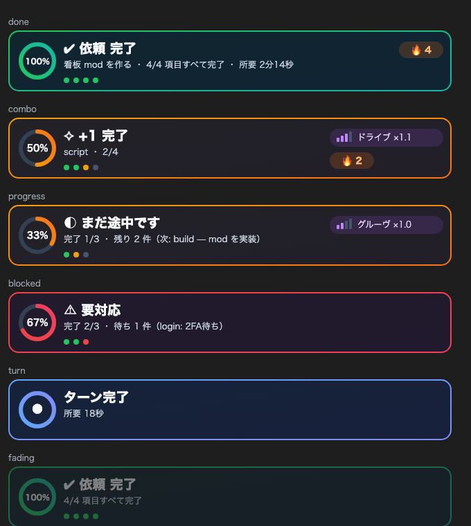

# done-board

Claude Code の作業を、看板・作業BGM・ご褒美の音で見えるようにするプラグインです。
項目を1つ終えるたびにコンボ音が鳴り、残りが減るほど BGM が速くなります。



## インストール

Claude Code をターミナルで開き、プロンプトに次の1行を入力します。

```
/plugin install done-board --marketplace bw-bit/done-board
```

`Add marketplace?` には `y` を押し、スコープを選びます。ユーザースコープで入れると、デスクトップアプリの Code タブのセッションでも動きます。

## 何をするか

| 場面 | 看板 | 音 |
| --- | --- | --- |
| 作業が始まる | — | 進み具合に合ったテンポで BGM を流す |
| 項目が1つ終わる | `+1 完了` と 🔥 連続数 | コンボ音（連続するほど高くなる） |
| テンポが上がる | テンポメーターの点灯が増える | レベルアップ音のあと、速い曲に切り替わる |
| 残り1件 | — | ラストスパート（×1.22）の曲 |
| 人の操作待ち | 赤い「要対応」と理由 | BGM を止める |
| 依頼がすべて終わる | リングが満ちる完了カード | BGM を止めてファンファーレ |
| 台帳のない短いやり取り | 小さな「ターン完了」 | 鳴らさない（30秒以上かかったターンだけ鳴らす） |

看板は 14 秒ほどで薄くなってから消えます。右端の ✕ でも消せます。デスクトップでは進捗リング付きのカード、ターミナルでは枠付きの2段表示になります。

BGM のテンポは4段階です。

| 段階 | 速さ | 切り替わる目安 |
| --- | --- | --- |
| ウォームアップ | ×0.92 | 完了 1/3 未満 |
| グルーヴ | ×1.0 | 1/3 以上 |
| ドライブ | ×1.1 | 2/3 以上 |
| ラストスパート | ×1.22 | 残り1件 |

## 完了台帳

看板とテンポは、作業フォルダの `work/autonomy/completion-<session_id>.json` を読んで決まります。Claude にこの形式で台帳を書かせると動きます。

```json
{
  "status": "running",
  "request_summary": "集計スクリプトを作る",
  "items": [
    { "id": "plan", "status": "done", "note": "手順を決める" },
    { "id": "script", "status": "running", "note": "スクリプトを書く" },
    { "id": "report", "status": "pending", "note": "結果をまとめる" }
  ]
}
```

`status` は `pending`・`running`・`done`・`blocked` のどれかです。台帳がないときは、ターンの終わりに「ターン完了」だけを出します。

## コマンド

- `/bgm` — BGM の状態と連続数を表示
- `/bgm off` — BGM を止める（このセッションのあいだ）
- `/bgm on` — BGM を再開する

## 設定

`/plugin` の設定画面で変えられます。

| 項目 | 既定 | 内容 |
| --- | --- | --- |
| `ledgerDir` | `work/autonomy` | 台帳を置くフォルダ。相対パスは作業フォルダ基準 |
| `music` | オン | 作業 BGM |
| `musicVolume` | 0.35 | BGM の音量（0〜1） |
| `effects` | オン | コンボ音・レベルアップ音・ファンファーレ |
| `debugLog` | オフ | 作業フォルダの `.claude/done-board-debug.log` に動作を記録 |

## 動く環境

- 音は macOS の `afplay` で再生します。Linux と Windows のターミナルでは音は鳴らず、看板だけが出ます。
- 看板は入力欄の上の帯に出ます。デスクトップアプリとターミナルの両方で描けます。

## 開発

```
claude plugin validate .
claude plugin test .
```

## 素材

- BGM は Google の Lyria（Vertex AI `lyria-002`）で生成した曲をループ加工し、4つのテンポに書き出したものです。
- 効果音はコードで合成しています。

## ライセンス

MIT
